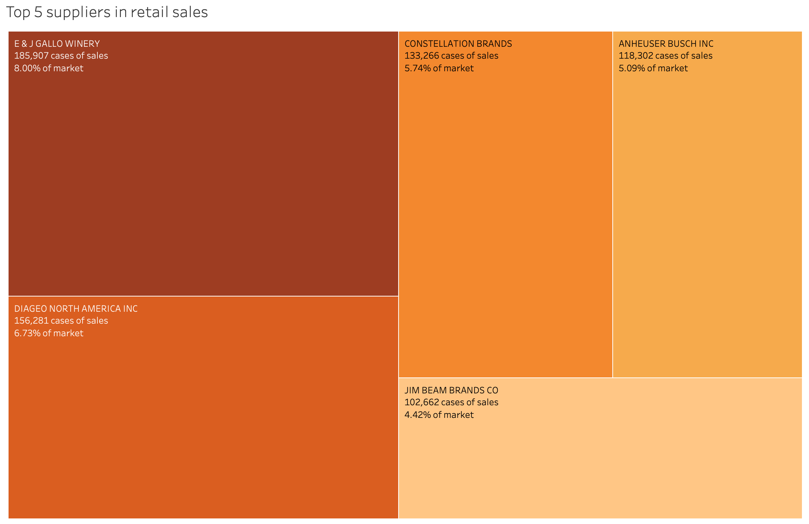
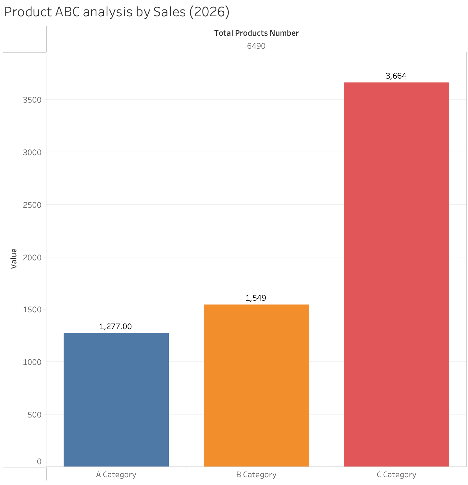

# Maryland Alcohol Sales: Market Structure Analysis

SQL + Tableau analysis of retail alcohol sales in Montgomery County, Maryland. The project answers two business questions:

1. **How concentrated is the supplier market?** Do a few suppliers control sales, or is the market fragmented?
2. **Which products drive sales?** How many SKUs generate 80% of volume, and how long is the tail?

**Live dashboard:** [Retail Sales & Market Structure Dashboard (Tableau Public)](https://public.tableau.com/app/profile/alpamis.adilbekov/viz/RetailSalesMarketStructureDashboard/Dashboard1)

**Tools:** PostgreSQL · SQL (CTEs, window functions) · Tableau · Excel

---

## Key Findings

| Metric | Result |
|---|---|
| Unique suppliers in dataset | 542 |
| Suppliers with positive retail sales | 474 |
| Herfindahl-Hirschman Index (HHI) | **315** (unconcentrated market) |
| Effective number of suppliers (10,000 / HHI) | **~32**, versus 474 nominal |
| ABC analysis, 2026 (A / B / C) | **1,277 / 1,549 / 3,664** items |

- **Nominal fragmentation hides real concentration.** The market has 474 active suppliers, but its structure is equivalent to about 32 equally sized ones. The top-5 suppliers carry a disproportionate share of volume (see chart below).
- **Pareto holds for products.** About 20% of SKUs (1,277 of 6,490) generate 80% of 2026 retail volume. More than half of the assortment (3,664 items) adds only the last 5%.
- **Implication:** assortment decisions should focus on class A, while class C is a candidate for rationalization.




---

## Data

- **Source:** [Warehouse and Retail Sales, Montgomery County, MD (data.gov)](https://catalog.data.gov/dataset/warehouse-and-retail-sales)
- **Size:** about 341K rows, 9 columns: year, month, supplier, item code, item description, item type, retail sales, retail transfers, warehouse sales
- **Unit:** cases
- The CSV is not stored in this repository. Download it from the link above and save it as `MarylandAlcoholSales.csv` in the project root.

### Data quality issues found and handled

- **Negative values written in parentheses**, e.g. `(1.00)`, broke the numeric cast. They were parsed as negative numbers (returns/adjustments).
- **Thousand separators** (commas) in numeric fields.
- **Empty strings** converted to `NULL`.
- **6 NULL values in `retail_sales`** and **204 NULL suppliers**. All belong to `NON-ALCOHOL` items, which are excluded from the analysis.
- **Missing months.** Not all periods are present in the dataset, so a reliable time-series trend cannot be built. The analysis is therefore structural (market shares, concentration), not trend-based.

---

## Methodology

- **HHI** = sum of squared supplier shares of retail sales (in %). The effective number of suppliers is `10,000 / HHI`.
- **ABC analysis** uses cumulative share of 2026 retail sales by product: **A** = first 80%, **B** = next 15%, **C** = last 5%. A product's class is set by its cumulative share *before* it is added, so the item that crosses a threshold stays in the higher class.
- Scope: `NON-ALCOHOL` items and rows with non-positive sales are excluded.

---

## Repository Structure

```
.
├── sql/
│   ├── 01_import.sql             # raw table creation and CSV import (psql \copy)
│   ├── 02_data_cleaning.sql      # type cleaning, final `sales` table
│   ├── 03_data_analysis.sql      # EDA, supplier HHI, ABC analysis
│   └── 04_for_visualization.sql  # queries feeding the dashboard
├── viz/
│   ├── 05_for_viz.json
│   └── excel/                    # query outputs used in Tableau (1-7)
├── images/                       # dashboard screenshots
└── README.md
```

## How to Reproduce

1. Download the CSV (link above) into the project root.
2. Create a PostgreSQL database and run `sql/01_import.sql`. Adjust the `\copy` path if needed.
3. Run `sql/02_data_cleaning.sql` to build the clean `sales` table.
4. Run `sql/03_data_analysis.sql` for the analysis, and `sql/04_for_visualization.sql` for the dashboard datasets.

---

## Author

**Alpamis Adilbekov**: Master's student in Management for Sustainable Firms (Smart Manufacturing), University of Padova.

[Tableau Public](https://public.tableau.com/app/profile/alpamis.adilbekov) · [GitHub](https://github.com/Alpamisdev)